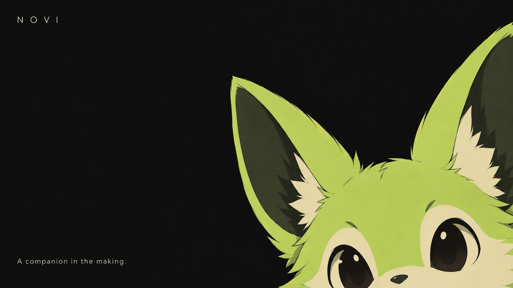
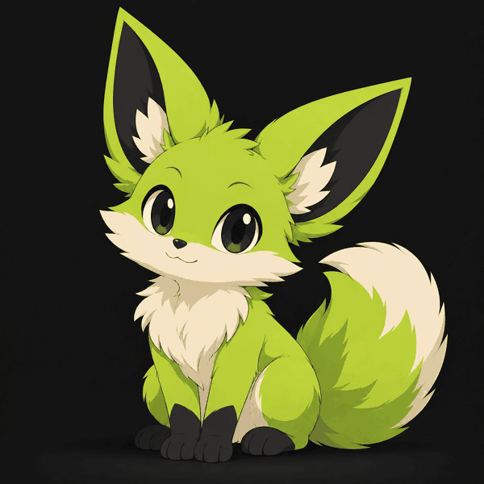
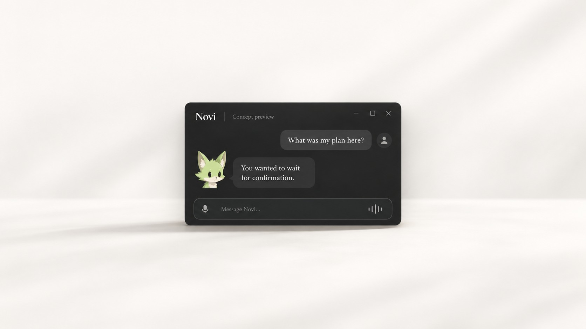
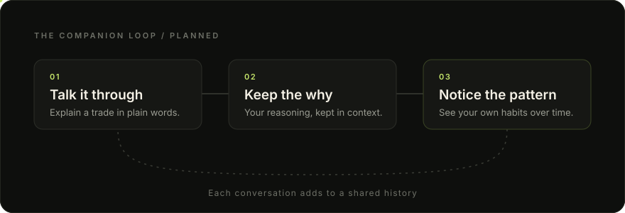
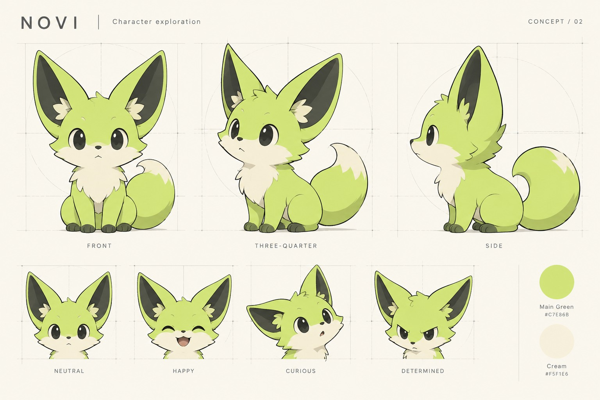
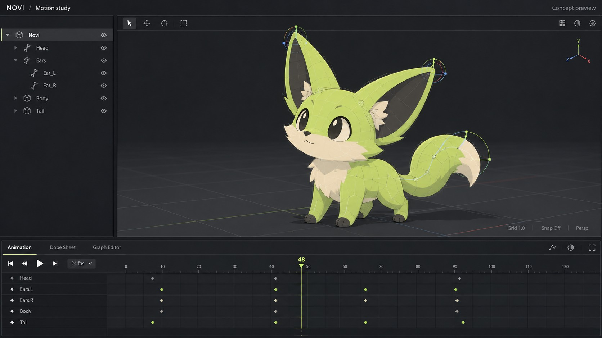
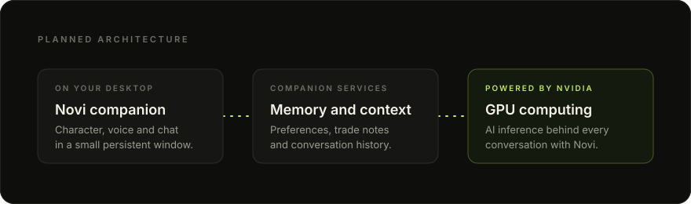
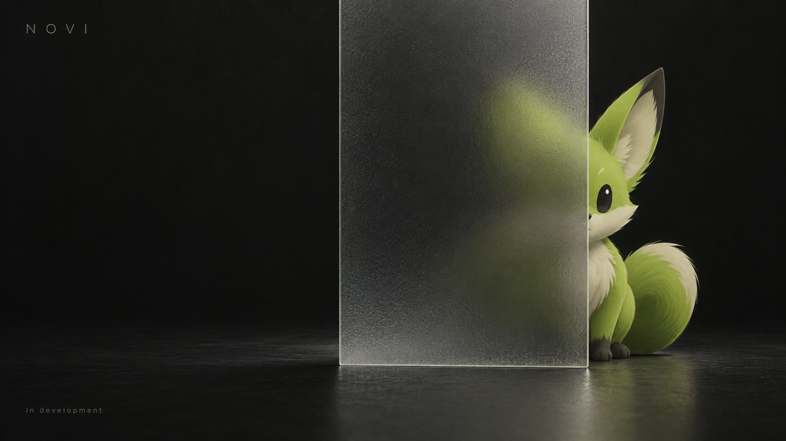

  

  

<h1 align="center">Novi</h1>

  <strong>An AI trading companion that lives on your desktop and remembers why you made each trade.</strong>

  <a href="#what-novi-is">About</a>
  &nbsp;&middot;&nbsp;
  <a href="#the-companion-experience">Experience</a>
  &nbsp;&middot;&nbsp;
  <a href="#character-and-interaction">Design</a>
  &nbsp;&middot;&nbsp;
  <a href="#infrastructure">Infrastructure</a>
  &nbsp;&middot;&nbsp;
  <a href="#roadmap">Roadmap</a>
  &nbsp;&middot;&nbsp;
  <a href="#status">Status</a>

 

Most trading tools are built to show you more data. Novi is built to help you understand yourself. It is a small companion that stays with you while you trade, listens as you talk through your decisions, and keeps a shared history you can come back to.

Novi is in early development. This repository is where the project takes shape in public.

 

## What Novi is

<table>
  <tr>
    <td width="42%" valign="middle">
      
    </td>
    <td width="58%" valign="middle">
      
Novi is a persistent desktop companion, represented by a small green animal with oversized ears and a quiet, attentive personality.

      
The idea is simple. Instead of filling in a trading journal after the fact, you talk to Novi as you go. Over time, Novi learns your preferences, remembers your reasoning, and helps you recognize your own habits.

      
<strong>Novi is planned as a thinking partner, not a signal service.</strong> It is not intended to tell you what to buy or sell. Its job is to help you see your own process more clearly.

    </td>
  </tr>
</table>

 

## The companion experience

  

The planned experience centers on a small window that stays open beside your charts. You can type or speak to it, and Novi answers with the context of everything you have shared before.

  

What we are designing toward:

- **Natural conversation.** Talk through a trade in your own words, by text or voice, without forms or tags.
- **Reasoning you can revisit.** Ask "what was my plan here?" and get your own answer back, in your own words.
- **Memory of your preferences.** Novi learns how you like to work, from risk habits to the setups you trust.
- **Gentle pattern recognition.** Over weeks and months, Novi can point out recurring habits so you can decide what to keep and what to change.
- **A companion that stays.** Novi is meant to be present on your desktop rather than buried in another browser tab.

All of the above describes the intended product. None of it is available as working software yet.

 

## Character and interaction

Novi's character is being developed alongside the product, because a companion you see every day should feel consistent and calm. The design keeps a restrained palette, a soft silhouette, and a small range of readable expressions.

  

The character sheet defines Novi's proportions, turnarounds, and a first set of expressions: neutral, happy, curious, and determined. Each one is intended to map to a moment in conversation, such as listening, recalling a past decision, or flagging a pattern.

  

Motion is planned to stay subtle. Ears, head, and tail are separated so Novi can react with small gestures, like a tilt or an ear flick, instead of large animations that pull focus from your charts.

See [`docs/character.md`](docs/character.md) for palette and character guidelines.

 

## Infrastructure

  

**Powered by NVIDIA.** Planned infrastructure uses NVIDIA GPU computing to support Novi's AI inference and companion experience.

A companion only works if it responds quickly and holds context well. GPU computing gives Novi the headroom to keep conversations responsive while drawing on a growing history of your notes and preferences.

 

## Roadmap

  

| Phase | Focus | Status |
| :-- | :-- | :-- |
| **01 Identity** | Character, voice, visual language, interaction concepts | In progress |
| **02 Prototype** | Desktop window, conversation, trade notes | Planned |
| **03 Memory** | Preferences, reasoning history, habit reflection | Planned |
| **04 Early access** | Private testing with a small group of traders | Planned |

A more detailed breakdown lives in [`ROADMAP.md`](ROADMAP.md). Phases and scope may change as the project develops.

 

## Status

  

**Where things stand today**

- Character design, palette, and expression set
- Interaction and interface concepts
- Early motion and rigging studies

**Not yet available**

- A downloadable app or public build
- Conversation, memory, or any AI features
- Any connection to brokers, exchanges, or market data

There is no installation step yet. When a build is ready to try, it will be announced here first.

### Links

- [Roadmap](ROADMAP.md)
- [Character guidelines](docs/character.md)
- [Contributing and feedback](CONTRIBUTING.md)
- [Open an issue](../../issues) to share ideas or questions
- Watch this repository to follow development

 

---

  Novi is a work in progress. Artwork and character design are all rights reserved.

